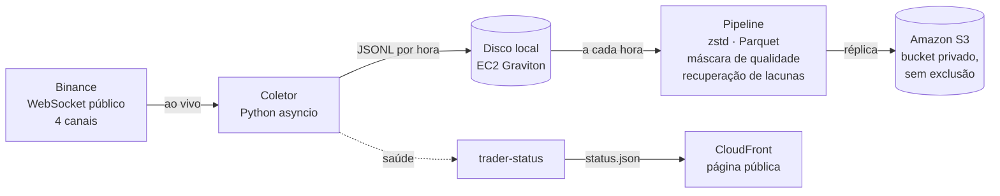

# MEVIS

**Market Evidence Intelligence System** — um sistema de pesquisa que coleta, 24 horas por dia, os dados públicos de mercado do par **BTC/USDT na Binance** e vai usá-los para testar, com método, se existe algum sinal útil em minutos.

**Status ao vivo da coleta:** https://d3atevbsy0cc9c.cloudfront.net (só métricas do sistema; nenhum preço)

> Projeto de estudo. Não há dinheiro real, alavancagem nem chaves de conta real em nenhuma fase do MVP. Nada aqui é recomendação de investimento, e "não há evidência de vantagem" é um resultado tão válido quanto o contrário.

## A pergunta

Um modelo que combina candles, volume, fluxo de negócios e livro de ofertas produz decisões com expectativa positiva, **depois dos custos**, fora da amostra e melhor do que alternativas simples (não operar, comprar e segurar, entradas aleatórias, uma regra de rompimento)?

Para a resposta valer, o método foi fixado **antes** de qualquer experimento ([doc 04](docs/04-ai-research.md)): horizontes, alvo, custos, períodos de prova lacrados e os critérios de aprovação estão pré-registrados no Git.

## Fases

| Versão | O que entrega | Situação |
|---|---|---|
| **V0.1 — Data Engine** | Coleta contínua, validação e armazenamento dos dados | Em operação na AWS desde 23/10/2026 |
| **V0.2 — Pesquisa** | Features sem olhar o futuro, backtester com custos, baselines, regressão logística e XGBoost, ablações | Método aprovado; implementação a seguir |
| **V0.3 — Paper trading** | Operação simulada ao vivo, com gerenciador de risco independente do modelo | Não iniciada |
| **V0.4 — Macro** | Notícias e macro como filtro de risco | Depois do MVP |

## Como a coleta funciona



- **Quatro canais:** cada negócio, o candle de 1 minuto, a foto dos 20 melhores níveis do livro a cada 100 ms e as mudanças do livro a cada 100 ms.
- **Grava antes de interpretar:** cada mensagem é guardada como chegou, com o horário de recebimento. Tudo o mais pode ser reprocessado a partir dela.
- **Sem lacunas na troca de conexão:** a conexão é renovada a cada 23 h, e também quando um canal fica em silêncio, abrindo a nova antes de fechar a antiga. A implantação de versões troca entre duas instâncias do coletor (a/b) da mesma forma.
- **Lacunas detectadas e recuperadas:** sequências de ids de negócios e do livro são conferidas ao vivo. O que falta é buscado de volta nos dados públicos da Binance quando existe, e cada minuto de cada canal fica marcado como completo, recuperado ou perdido.
- **Relógio medido:** o offset em relação ao servidor da Binance é medido com rajadas de pedidos, usando a amostra de menor ida e volta.
- **Infraestrutura como código:** Terraform na AWS (us-east-2). O servidor não tem portas de entrada (acesso só pelo SSM). Há logs, métricas e 9 alarmes no CloudWatch, com aviso por e-mail.
- **Histórico importado** dos arquivos públicos da Binance: ~1,4 bilhão de negócios (1 ano) e ~2 milhões de candles de 1 minuto (desde 2023).

## Estrutura

```text
src/trader/
  core/        modelos canônicos, unidades de tempo, decimais (sem E/S)
  normalize/   mensagens da Binance → registros canônicos
  quality/     validação, sequências, máscara de qualidade (sem E/S)
  sources/     WebSocket, REST com limite de peso, arquivos públicos
  ingest/      coletor: sessões, rotação, gravação bruta, relógio
  storage/     layout de arquivos, Parquet, réplica no S3
  recovery/    recuperação de lacunas
  pipeline/    rodada horária, backfill, relatório de qualidade, página de status
  public/      página pública de status (HTML estático)
  ops/         configuração, logs, métricas, saúde, estado em SQLite
  cli/         comandos `trader ...`
infra/         Terraform (rede, bucket, host do coletor, observabilidade, página pública)
docs/          PRD, requisitos, arquitetura, dados, pesquisa
tests/         testes automatizados (pytest)
```

## Desenvolvimento

Requer [uv](https://docs.astral.sh/uv/) (Python 3.12).

```bash
uv sync
uv run pytest
uv run ruff check .
uv run mypy
```

Coleta local curta e uma rodada do pipeline:

```bash
uv run trader collect --data-dir data/local --duration 120
uv run trader status --data-dir data/local
uv run trader pipeline --data-dir data/local
```

Os dados ficam em `data/`, fora do Git: os dados de mercado são da Binance e não são redistribuídos aqui.

## Documentação

A documentação vem antes do código: nada é implementado sem o documento correspondente aprovado. O índice e o estado de cada documento estão em [docs/README.md](docs/README.md); a operação na AWS, em [infra/README.md](infra/README.md).

## Licença

[MIT](LICENSE). Dados de mercado: Binance.
